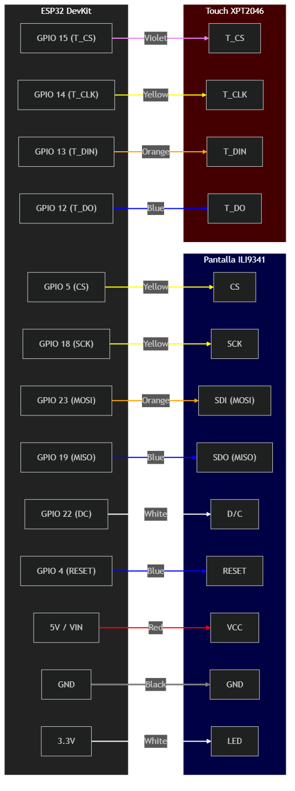

# TuBondi Tracker · ESP32

**Próximos colectivos en una pantalla física de estilo LED.**

Un proyecto de **ESP32 + pantalla TFT ILI9341 + táctil XPT2046** para consultar arribos de Tu Bondi mediante Wi-Fi y mostrarlos como si fueran los carteles electrónicos de las paradas. La parada y la red se pueden configurar desde un portal local, sin recompilar para cada cambio.

| Pantalla | Conectividad | Interacción |
| :-- | :-- | :-- |
| Arribos, distancia y reloj sincronizado. | Wi-Fi con portal de configuración. | Botones táctiles para actualizar y entrar a ajustes. |

**Empezá por:** [pines y conexiones](#diagrama-de-conexiones-wiring) · [primer encendido](#configuración-inicial) · [PlatformIO](#instalación-con-platformio).

> [!IMPORTANT]
> **La tabla de pines es la referencia para cablear.** El [diagrama existente](wiring_diagram_final.png) sirve como orientación visual, pero contrastá siempre cada conexión con la configuración real de `platformio.ini` y el código.

**Entorno del proyecto:** PlatformIO, framework Arduino y placa `nodemcu-32s`. El archivo [`platformio.ini`](platformio.ini) fija inicialmente `COM3` como puerto de carga/monitor; ajustalo al puerto de tu equipo.

## Características

- **Visualización en Tiempo Real**: Muestra los próximos arribos, distancias y tiempos de espera.
- **Reloj NTP**: Hora sincronizada automáticamente vía internet (GMT-3 Argentina).
- **Configuración Dinámica**: Portal WiFi cautivo para cambiar la Parada (StopCode) y credenciales WiFi sin tocar el código.
- **Doble Bus SPI**: Optimizado con VSPI para la pantalla y HSPI para el táctil, garantizando fluidez y evitando interferencias.
- **Filtro de Ruido Táctil**: Algoritmo para ignorar "ghost touches" y pulsaciones accidentales.

---

## Diagrama de conexiones (wiring)

> [!IMPORTANT]
> **La tabla de pines y `platformio.ini` son la referencia principal.** Usá el diagrama como orientación, no como única fuente para el cableado.

### Tabla de Pines (Source of Truth)

| Función | Pin ESP32 | Pin Pantalla | Cable (Tu Hardware) | Bus / Tipo |
| :--- | :--- | :--- | :--- | :--- |
| **VCC** | **5V / VIN** | VCC | **Rojo** | Alimentación |
| **GND** | GND | GND | **Negro** | Tierra |
| **TFT CS** | **GPIO 5** | CS | **Amarillo** | VSPI |
| **TFT RESET**| **GPIO 4** | RESET | **Azul** | Digital |
| **TFT DC** | **GPIO 22** | D/C | **Blanco** | Digital |
| **TFT MOSI** | **GPIO 23** | SDI (MOSI) | **Naranja** | VSPI |
| **TFT SCK** | **GPIO 18** | SCK | **Amarillo** | VSPI |
| **TFT LED** | **3.3V** | LED / BL | **Blanco** | Brillo |
| **TFT MISO** | **GPIO 19** | SDO (MISO) | **Azul** | VSPI |
| **T_CLK** | **GPIO 14** | T_CLK | **Amarillo** | HSPI (Touch) |
| **T_CS** | **GPIO 15** | T_CS | **Violeta** | HSPI (Touch) |
| **T_DIN** | **GPIO 13** | T_DIN (MOSI)| **Naranja** | HSPI (Touch) |
| **T_OUT** | **GPIO 12** | T_DO (MISO) | **Azul** | HSPI (Touch) |

---

### Guía visual (esquema técnico)

Para una referencia rápida del ruteo, podés usar este diagrama generado con **Mermaid CLI**. Representa los dos buses SPI (VSPI para pantalla y HSPI para táctil).



> [!TIP]
> **Recordá usar siempre la TABLA DE ARRIBA** para conectar los cables, ya que es la única fuente de verdad que coincide exactamente con el código del programa.

---

## Configuración inicial

1. **Primer Inicio**: La placa intentará conectarse. Si no hay WiFi configurado o falla, se pondrá en modo **Portal**.
2. **Conexión Local**: Conectate desde tu celular a la red WiFi llamada `BondiTracker-Setup`.
3. **Portal Web**: Entra a `http://192.168.4.1` en tu navegador.
4. **Parámetros**:
   - Configura tu red WiFi.
   - Ingresa el **Stop Code** (ej. `A911`).
   - Guarda los cambios. El dispositivo se reiniciará solo.

## Controles de interfaz

- **Botón REFRESH (Naranja)**: Actualiza los arribos manualmente en cualquier momento.
- **Icono Engranaje (Gris)**: Fuerza al dispositivo a entrar en modo configuración. Sugerido para cuando quieras cambiar la parada o la red WiFi.
- **Botón VOLVER (Rojo)**: Dentro del modo configuración, permite salir y volver a la pantalla principal sin guardar cambios (reinicia el dispositivo).

---

## Instalación con PlatformIO

Asegúrate de tener instaladas las siguientes librerías en tu `platformio.ini`:

```ini
lib_deps = 
    bodmer/TFT_eSPI @ ^2.5.43
    https://github.com/PaulStoffregen/XPT2046_Touchscreen
    bblanchon/ArduinoJson @ ^7.0.4
    https://github.com/tzapu/WiFiManager @ ^2.0.17
```

*Desarrollado para la comunidad de entusiastas de ESP32 y transporte público.* 🚍✨

## Licencia

No se encontró un archivo de licencia en el repositorio.
